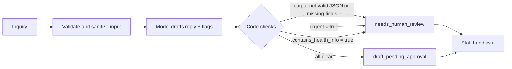

# clinic-automation-demos

Bilingual (EN/FR) workflow automation demos for small clinics, built with n8n + Claude API.

All data in this repository is synthetic. The clinic in the demos ("Clinique Physio Rideau (DEMO)") is fictional, and every name, email and phone number in the test payloads is made up (`example.com` emails, `555-01xx` phone numbers).

## Goal

Small private clinics (physiotherapy, dental, massage, etc.) lose new patients when web inquiries wait hours for a reply, and in a bilingual market the reply has to come back in the patient's language. These demos show how a low-cost, self-hosted workflow can:

- answer an inquiry in English or French within seconds,
- keep a human in control of anything patient-facing (draft only, nothing is sent automatically),
- route anything sensitive (health details, urgent wording) to a person instead of the model.

## Demos

| # | Demo | Status |
|---|---|---|
| 01 | [Bilingual lead capture and instant reply draft](demos/01-bilingual-lead-capture/) | Built. Mock path tested. Real Claude path not tested yet. |
| 02 | Review-request automation (bilingual) | Planned |
| 03 | Appointment reminders and no-show recovery | Planned |
| 04 | Weekly clinic KPI summary | Planned (stretch) |

## Guardrail design (health info and urgent messages go to a human)

The model only drafts. Code, not the model, decides whether a draft may move forward.



1. **Input hygiene before the model.** HTML is stripped, fields are length-capped, a honeypot field catches bots, and required fields are checked. Bad input never reaches the API.
2. **Narrow system prompt.** The model must reply in the patient's language, never give medical advice or ask for health details, never repeat health details back, and tell the person to call 911 or go to the nearest emergency department if the message suggests an emergency.
3. **Structured output.** The model must return JSON with `language`, `intent`, `urgent`, `contains_health_info`, `subject`, `body`.
4. **Deterministic routing in code.** A Code node parses the output. If parsing fails, a required field is missing, `urgent` is true, or `contains_health_info` is true, the status is `needs_human_review`. Otherwise it is `draft_pending_approval`. Neither status sends anything.
5. **Fail closed.** Any doubt (bad model output, timeout after retry) lands on a person, not on the patient.

Known limit: flags come from the model's own judgement, so a missed flag is possible. A keyword pre-check that does not depend on the model is on the roadmap.

## Test matrix (honest status)

Six synthetic payloads live in [`demos/01-bilingual-lead-capture/test-payloads/`](demos/01-bilingual-lead-capture/test-payloads/). All results below were run on the **mock path** only (`"mock": true`), where a small rule-based Code node stands in for the model. **The real Claude API path has not been tested yet.** Mock output is not AI output and is not presented as such.

| Payload | Expected | Mock path result | Real Claude path |
|---|---|---|---|
| 01 French booking request | French draft, `draft_pending_approval` | Pass (FR detected, draft pending approval, about 30 to 75 ms) | Not tested |
| 02 English pricing question | English draft, `draft_pending_approval` | Pass | Not tested |
| 03 Message with health details | `needs_human_review` | Pass (routed to human) | Not tested |
| 04 Urgent wording (chest pain) | `needs_human_review` | Pass (routed to human). Note: the mock reply does not include the 911 instruction; only the real prompt asks for it. | Not tested |
| 05 Honeypot spam | Rejected | Rejected, but returns a generic HTTP 500 instead of a clean 400 | Not tested |
| 06 Invalid input | Rejected | Rejected, but returns a generic HTTP 500 instead of a clean 400 | Not tested |

Not done yet: French output review by a native speaker, cost per run, a 10-run reliability check, and error-path testing against a real API failure.

## How to import and run

Requirements: Node.js and a local n8n install (tested on n8n 2.x, self-hosted Community edition).

1. Start n8n locally, bound to localhost only, for example:
   ```bash
   N8N_LISTEN_ADDRESS=127.0.0.1 npx n8n start
   ```
   Editor: http://localhost:5678
2. Import the workflow, either in the editor (**Workflows > Import from File** and pick `demos/01-bilingual-lead-capture/workflow.json`) or from the CLI with n8n stopped:
   ```bash
   npx n8n import:workflow --input=demos/01-bilingual-lead-capture/workflow.json
   ```
3. Activate the workflow, then send a test payload (mock path, no API key needed):
   ```bash
   curl -X POST http://localhost:5678/webhook/clinic-lead \
     -H "Content-Type: application/json" \
     --data-binary @demos/01-bilingual-lead-capture/test-payloads/01-fr-booking.json
   ```
4. To try the real Claude path (untested): create an n8n credential of type **Header Auth** named `Anthropic API key`, with header name `x-api-key` and your own key as the value, select it on the **Claude draft** node, set a spend limit on your Anthropic account, and send payloads with `"mock": false`.

No keys, credential IDs or instance-specific IDs are stored in this repo. The credential reference in `workflow.json` is a placeholder that you re-link after import.

## Roadmap

1. Run all six payloads on the real Claude path and publish the results, pass or fail.
2. Return a clean HTTP 400 for spam and invalid input instead of 500.
3. Add a model-independent keyword pre-check for urgent wording, and check that the urgent reply contains the 911 instruction.
4. Have the French output reviewed by a native speaker.
5. Log each inquiry to a sheet and notify staff (synthetic data only).
6. Measure cost per run and response time on the real path.
7. Build demos 02 to 04.

## Design notes

- [docs/design-decisions.md](docs/design-decisions.md): why n8n over Power Automate for these demos.

## License

MIT. See [LICENSE](LICENSE).
