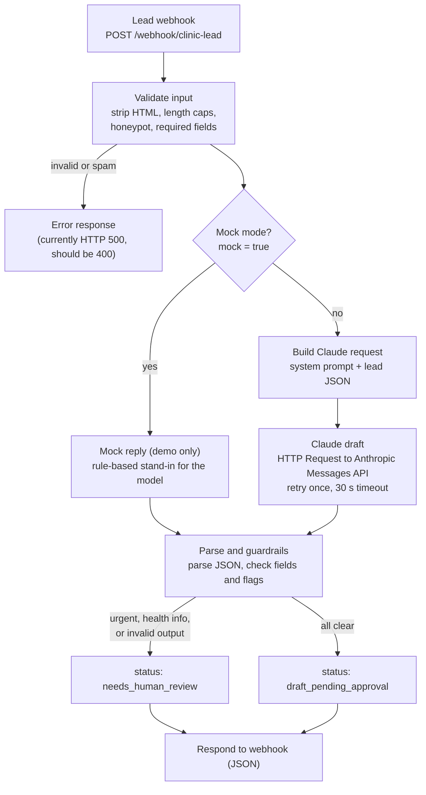

# Demo 01: Bilingual lead capture and instant reply draft

Synthetic data only. Fictional client: "Clinique Physio Rideau (DEMO)".

A clinic's website form posts a new-patient inquiry to an n8n webhook. The workflow validates the input, asks Claude to draft a short reply in the patient's language (English or French), applies guardrails in code, and returns the result as JSON. Nothing is sent to the patient: the output is either a draft waiting for staff approval or a flag for human review.

## Flow



## Nodes

| Node | Type | What it does |
|---|---|---|
| Lead webhook | Webhook | Receives `POST /webhook/clinic-lead` with `name`, `email`, `phone`, `message`, optional `clinic`, `mock`, and the hidden honeypot field `website`. |
| Validate input | Code | Strips HTML tags, trims and caps field lengths, rejects filled honeypot, checks name, email format and message length. |
| Mock mode? | If | Routes to the mock reply when `mock` is `true`, otherwise to the real model path. |
| Mock reply (demo only) | Code | Rule-based stand-in so the flow can be tested without an API key. Not AI output. |
| Build Claude request | Code | Builds the Messages API body: system prompt with the rules, user content with name and message only. |
| Claude draft | HTTP Request | Calls `https://api.anthropic.com/v1/messages` with a Header Auth credential (`x-api-key`). |
| Parse and guardrails | Code | Parses the JSON reply, checks required fields, sets `needs_human_review` if output is invalid, `urgent`, or `contains_health_info`. |
| Respond | Respond to Webhook | Returns status, reason, language, intent, the draft (if any) and response time. |

## Example response (mock path)

```json
{
  "status": "draft_pending_approval",
  "reason": null,
  "language": "fr",
  "intent": "new_booking",
  "draft": { "to": "camille.demo@example.com", "subject": "Votre demande de rendez-vous", "body": "Bonjour Camille, ..." },
  "source": "mock",
  "respondedInMs": 42,
  "lead": { "name": "Camille Tremblay", "clinic": "Clinique Physio Rideau (DEMO)" }
}
```

`respondedInMs` varies by run; the value above is illustrative.

## Test payloads

| File | Scenario |
|---|---|
| `01-fr-booking.json` | French booking request |
| `02-en-pricing.json` | English pricing and insurance question |
| `03-health-info.json` | Message that contains health details |
| `04-urgent.json` | Emergency wording |
| `05-spam-honeypot.json` | Bot that fills the hidden field |
| `06-invalid.json` | Empty name, bad email, too-short message |

Status per payload is in the [top-level test matrix](../../README.md#test-matrix-honest-status). Short version: all six behave as expected on the mock path (with the HTTP 500 issue for rejected input); **none has been run against the real Claude API yet.**

## Setup

See [How to import and run](../../README.md#how-to-import-and-run). After import, re-link the **Claude draft** node to your own Header Auth credential; the ID in `workflow.json` is a placeholder.

## Known issues

- Rejected input returns HTTP 500 instead of 400.
- The mock urgent reply lacks the 911 instruction (only the real prompt asks for it).
- The system prompt string in **Build Claude request** is double-escaped, so the model receives literal `\n` and `’` sequences instead of line breaks and apostrophes. Harmless for meaning but should be cleaned up before the real-path test.
- The model ID (`claude-haiku-5-5`) and `max_tokens: 600` have not been exercised against the live API.
